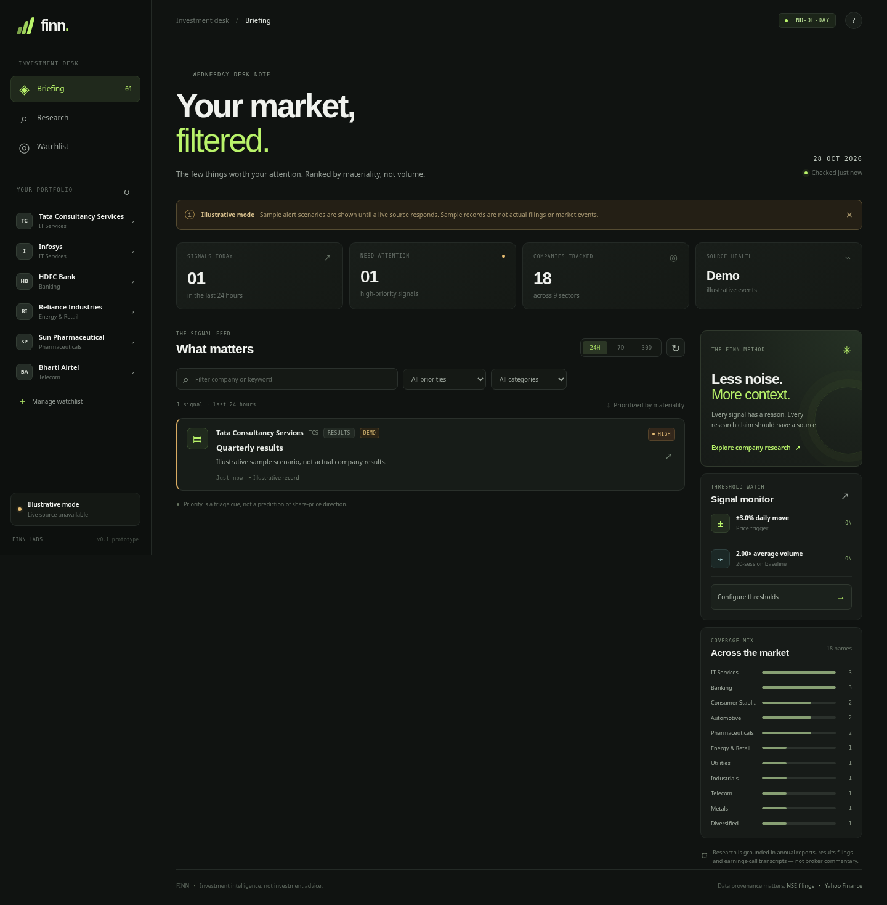
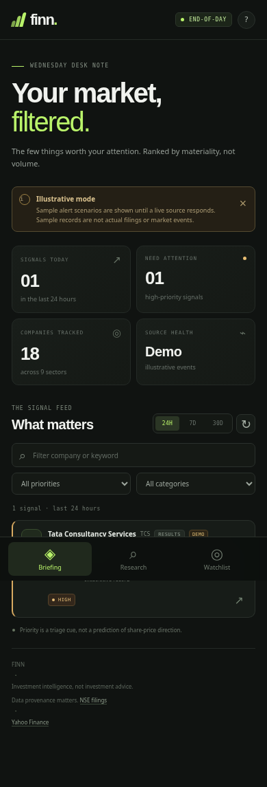
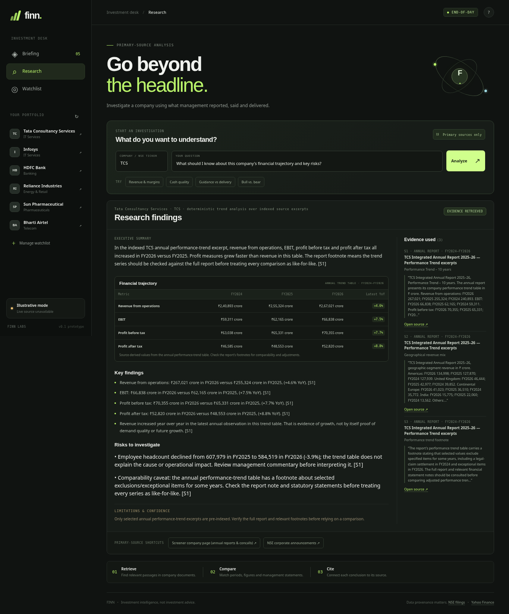

# FINN — Financial Investment Agent

A mobile-first prototype for the ENAM AI Engineer Build Challenge. FINN is organized around two workflows:

- **Push:** a prioritized corporate-announcement feed plus configurable end-of-day price and volume triggers.
- **Pull:** company research that retrieves passages from indexed primary documents and shows evidence/source links. If no company documents are indexed, it reports a coverage gap rather than inventing financial facts.

The project is intentionally small and runs as one FastAPI application serving a static responsive frontend. It does not require a JavaScript build step.

## Prototype integrity / source status

This repository is designed to be honest about source availability:

- Prices: best-effort public Yahoo Finance chart endpoint (`/v8/finance/chart/{symbol}`). If a request fails, the app displays an **illustrative synthetic price series** with a visible note.
- Announcements: best-effort public NSE corporate-announcements endpoint. If a request fails or access is denied, the app displays **synthetic scenarios marked DEMO**. These are not statements about the named companies and are not actual filings.
- Research: the repository includes one **curated excerpt pack** from TCS’s official FY2025–26 annual-report performance-trend table so the research workflow works on first launch. It is not a full annual report or a complete financial-statement extraction. Other tickers return a **coverage gap** until source documents are indexed. FINN will not fill missing facts from outside model knowledge.
- LLM: optional. Without `OPENAI_API_KEY`, research runs in retrieval-only mode; this is intentional and does not block the app from starting.

The upstream public web endpoints are not guaranteed APIs. Respect each source's terms, rate limits and access controls. If access is denied, the app falls back rather than attempting to bypass a block or CAPTCHA.

## Interface previews

The `screenshots/` folder contains representative captures of the briefing on desktop and mobile, plus the TCS research view. Demo-mode records in the briefing are deliberately marked as illustrative; the research view uses the curated annual-report excerpt documented below.







## Requirements

- Python 3.10+
- Internet connection only if you want to try the live-source adapters or download documents. The application and labeled demo mode can run offline.

## Run locally

```bash
cd finn-prototype
python -m venv .venv

# Windows PowerShell
.\.venv\Scripts\Activate.ps1

# macOS / Linux
source .venv/bin/activate

pip install -r requirements.txt
cp .env.example .env      # Windows: Copy-Item .env.example .env
uvicorn backend.app:app --host 127.0.0.1 --port 8000 --reload
```

Open <http://127.0.0.1:8000>. To expose it on your LAN for testing from a phone on the same network, run `uvicorn backend.app:app --host 0.0.0.0 --port 8000`; open the computer's LAN IP and port from the phone. Do not expose a development instance to the public internet.

## Main application routes

| Route | Purpose |
|---|---|
| `GET /api/health` | Health and document-coverage status |
| `GET /api/companies` | Search the initial 18-company portfolio |
| `GET /api/portfolio` | Portfolio registry |
| `GET /api/feed?days=1` | Prioritized announcements for 1, 7 or 30 days |
| `GET /api/company/{ticker}` | Company registry details, price snapshot, source shortcuts |
| `GET /api/prices/{ticker}?period=3mo` | Daily price/volume history and source mode |
| `GET /api/alerts/rules` | Read alert rules |
| `PUT /api/alerts/rules` | Save price/volume thresholds and preferred categories |
| `GET /api/alerts/preview` | Check example portfolio prices against the current alert rules |
| `POST /api/research` | Retrieve primary-source excerpts for an ad-hoc question |
| `GET /api/research/coverage` | Indexed documents and chunks by company |
| `GET /api/research/history` | Recent research requests |

Interactive API documentation is available at <http://127.0.0.1:8000/docs>.

## Ingest a primary source for Pull research

The initial document index at `data/documents/index.json` contains a single TCS performance-trend excerpt for demonstration. Use the ingestion script to add a publicly accessible annual report, quarterly results PDF, earnings-call transcript or investor presentation from a company or exchange source.

```bash
python scripts/ingest_document.py \
  --ticker TCS \
  --type annual_report \
  --period FY2025 \
  --title "TCS Annual Report FY2025" \
  --source-name "Company primary source" \
  --url "https://example.com/annual-report.pdf"
```

Replace the example URL with the actual document URL. Allowed types: `annual_report`, `quarterly_results`, `earnings_call`, `investor_presentation`, `exchange_filing`.

The script extracts PDF text (using page metadata when available) or readable HTML text, splits it into chunks, then stores the metadata and chunks in `data/documents/index.json`. It does not OCR scanned PDFs. If the PDF has no extractable text, run OCR separately and ingest a text/HTML representation or improve the ingestion step. The preloaded TCS metrics are from the performance-trend table in the [official TCS Integrated Annual Report 2025–26](https://www.tcs.com/content/dam/tcs/investor-relations/financial-statements/2025-26/ar/annual-report-2025-2026.pdf); the app links back to the source and flags the table-footnote comparability caveat. Verify figures in the full report before relying on them.

**Use only primary sources for Pull analysis.** The challenge explicitly rules out broker notes, news articles and research reports as the evidence base for company research. A company IR site, exchange filing, annual report and earnings-call transcript are appropriate starting points. Screener can be used to locate report/transcript links, but the indexed evidence should remain the company's own document.

After ingestion, restart the app if it is already running (or re-run the research request); no database migration is needed.

## Optional LLM synthesis

Without a key, FINN returns retrieved excerpts with a retrieval-only explanation. To allow the app to synthesize those passages, set these values in `.env`:

```env
OPENAI_API_KEY=your_key_here
OPENAI_MODEL=gpt-4.1-mini
OPENAI_BASE_URL=https://api.openai.com/v1
```

The model is prompted to answer only from retrieved passages, cite source markers and acknowledge insufficient evidence. This is a prototype guardrail, not a guarantee; verify the source text and period for any material claim. Never commit `.env` or API keys.

## Alert rules

Default demo thresholds:

- Absolute daily close move: ±3.0%
- Volume: at least 2.0× the average of the previous 20 trading sessions
- Announcement window: 24 hours

Threshold rules use end-of-day data and must not be represented as intraday alerts. The comparison volume window excludes the current observation. The demo preview checks three portfolio symbols to keep the interaction quick; it is not a full automated monitoring daemon.

## Test

```bash
pip install pytest
pytest -q
```

Current tests cover portfolio size, announcement classification, demo data labeling, safe behavior when research sources are missing, and threshold-trigger logic.

## Suggested next steps for a submission-ready version

1. Add a small, verified document pack for two or three companies and validate extractions by hand.
2. Add actual quarterly-results table extraction with scope/unit/period validation before displaying QoQ/YoY figures.
3. Persist upstream source records and refresh times; add retries/caching with source-friendly rate limits.
4. Add a background scheduler only after the core feed and research paths are stable.
5. Add a source-quality evaluation set (expected category, figures, period, citation) before widening coverage.
6. Deploy the responsive frontend/backend and test the full flow on a phone.

## Disclaimer

FINN is a prototype for research workflow evaluation, not investment advice. It does not execute trades, predict returns or recommend buying/selling securities. Sample records and synthetic prices are for interface testing only. Always verify information directly in exchange/company disclosures.
